# Database Architecture & Schema Documentation

**Project:** The Annotation Contradiction Atlas  
**Engine:** SQLite (with PostgreSQL dialect compatibility)  
**ORM:** SQLAlchemy 2.0  
**Enforcement:** `PRAGMA foreign_keys = ON;`  

---

## 1. Entity-Relationship Diagram

```mermaid
erDiagram
    Protein ||--o{ FunctionAnnotation : "has annotations"
    Protein ||--o{ ProteinFamilyMembership : "belongs to"
    ProteinFamily ||--o{ ProteinFamilyMembership : "classifies"
    Protein ||--o{ SequenceFeature : "contains motifs"
    Protein ||--o{ EmbeddingRecord : "has embeddings"
    Protein ||--o{ ModelResult : "evaluates"
    Protein ||--o{ ReviewFlag : "prioritizes"
    Protein ||--o{ BenchmarkCase : "serves as reference"
    AnalysisRun ||--o{ ModelResult : "records"
    AnalysisRun ||--o{ ReviewFlag : "produces"

    Protein {
        int id PK
        string accession UK "Indexed, e.g. P00533"
        string protein_name
        string gene_name "Indexed"
        string organism "Default: Homo sapiens"
        int taxonomy_id "Default: 9606"
        text sequence "Validated uppercase amino acids"
        int sequence_length
        boolean reviewed "Indexed (Swiss-Prot vs TrEMBL)"
        string protein_existence
        string source_url
        datetime retrieval_timestamp
    }

    FunctionAnnotation {
        int id PK
        int protein_id FK
        string functional_label "Indexed"
        string annotation_type "catalytic_activity, function_description"
        string evidence_code "e.g. ECO:0000269"
        string evidence_category "EXPERIMENTAL, PHYLOGENETIC, COMPUTATIONAL"
        string supporting_reference "e.g. PubMed:15374980"
        string source_field
        text provenance_details
    }

    ProteinFamily {
        int id PK
        string family_name "Indexed"
        string classification_source "Pfam, InterPro, UniProt"
        string external_identifier "Indexed, e.g. PF00069"
        text description
    }

    ProteinFamilyMembership {
        int id PK
        int protein_id FK
        int family_id FK
        string membership_source
        string membership_evidence
    }

    SequenceFeature {
        int id PK
        int protein_id FK
        string feature_name "VAIK, HRD, DFG"
        int start_position
        int end_position
        string detected_sequence
        string detected_status "canonical, variant, absent"
        string detection_method "regex_heuristic"
        string expected_context
        text evidence_or_limitation
    }

    EmbeddingRecord {
        int id PK
        int protein_id FK
        string model_name "facebook/esm2_t6_8M_UR50D"
        string model_version
        string pooling_method "mean_pool"
        int embedding_dim "320"
        string artifact_path "Path to .npy artifact on disk"
        datetime computation_timestamp
        text preprocessing_details
    }

    ModelResult {
        int id PK
        int protein_id FK
        int run_id FK
        string method_name "sequence_similarity, esm2_anomaly"
        string model_version
        float anomaly_score "Normalized [0.0, 1.0]"
        float similarity_score
        string reference_protein_accession
        float threshold
        boolean is_outlier
        text result_explanation
        datetime created_at
    }

    ReviewFlag {
        int id PK
        int protein_id FK
        int run_id FK
        string review_priority "Indexed: HIGH, MODERATE, LOW"
        float contradiction_score "Composite [0.0, 1.0]"
        text flag_reason
        text supporting_evidence_summary
        text contradictory_signals
        text limitations
        string review_status "PENDING, INSPECTED, CONFIRMED_ANOMALY"
        datetime timestamp
    }

    BenchmarkCase {
        int id PK
        int protein_id FK "Nullable for synthetic"
        string synthetic_identifier UK
        string case_type "CATEGORY_A, CATEGORY_B, CATEGORY_C"
        string ground_truth_category "CONGRUENT, INCONSISTENT_CATALYTIC, LABEL_MISMATCH"
        boolean is_inconsistent
        text label_rationale
        string source_reference
        text synthetic_modification_details
        string dataset_split "REFERENCE, CALIBRATION, TEST"
        int random_seed
        datetime created_at
    }

    AnalysisRun {
        int id PK
        string run_identifier UK "Indexed"
        string dataset_version
        text configuration "JSON serialized"
        text model_versions "JSON serialized"
        int random_seed
        datetime start_time
        datetime completion_time
        string run_status "RUNNING, COMPLETED, FAILED"
        text evaluation_summary "JSON serialized"
    }
```

---

## 2. Table Specifications and Design Principles

### A. Lean Relational Storage vs Dense Artifact Separation
Storing large 320-dimensional or 1280-dimensional floating point vectors inside relational rows causes database bloat, degrades B-tree query caching, and slows down join performance.
- The `embedding_records` table holds strictly lightweight metadata (`artifact_path`, `model_name`, `dimension`, `computation_timestamp`).
- The dense array is saved on disk as an optimized binary `.npy` artifact under `data/embeddings/`.

### B. Foreign Key Integrity and Cascades
- `ON DELETE CASCADE` is enforced on `FunctionAnnotation`, `SequenceFeature`, `EmbeddingRecord`, `ModelResult`, and `ReviewFlag`. When a protein record is removed or updated, dependent records are cleaned up without orphan remnants.
- SQLite foreign key constraints are activated via connection hook: `PRAGMA foreign_keys = ON;`.

### C. Indexing Strategy
- `idx_protein_accession_reviewed`: Composite index for rapid kinome filtering by curated status.
- `idx_flag_priority_protein`: Optimized index for immediate querying of high/moderate priority review candidates.
